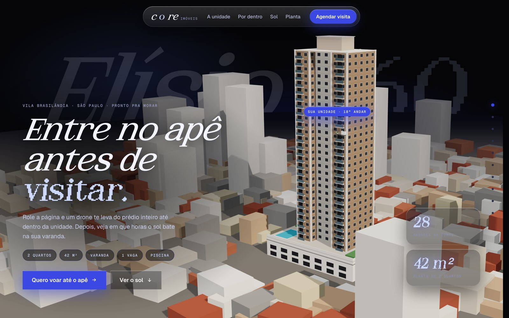

# Site 3D com Claude + Blender

Um site onde a câmera voa do prédio inteiro até dentro de um apartamento, passeia pelos cômodos e simula o sol por hora e estação do ano. Tudo foi construído numa live, só com Claude (Fable 5.2) no Claude Code e o Blender rodando por script. Nenhum modelo 3D foi baixado e nenhum gerador de 3D foi usado.

**Ver funcionando:** https://apto-3d-demo.maxcarrau.workers.dev



## Quero fazer o meu

Você não precisa entender este código. Três caminhos, do mais fácil pro mais técnico:

1. **Mande o PDF pro seu Claude.** Abra o Claude Code numa pasta vazia, anexe `guia/guia-site-3d.pdf` e escreva: *"Leia este guia e comece pelo passo 1. Meu negócio é ___ e o objeto 3D é ___."*
2. **Cole o prompt mestre.** Está em [`PROMPT.md`](PROMPT.md). Troque o que está entre chaves.
3. **Parta deste repositório.** Clone e peça: *"Adapte este site pro meu negócio ___, trocando o objeto por ___."*

Serve pra qualquer objeto: produto, móvel, máquina, planta de imóvel, estande, embalagem.

## O que você precisa ter instalado

- [Claude Code](https://claude.com/claude-code)
- [Blender](https://www.blender.org/download/) 4 ou mais novo (no Mac: `brew install --cask blender`)
- Python 3 com Pillow e NumPy: `pip3 install pillow numpy`

## Rodar na sua máquina

```bash
git clone https://github.com/maximilianocarrau123-debug/site-3d-claude-blender.git
cd site-3d-claude-blender/site
python3 -m http.server 4317
# abra http://localhost:4317
```

## Refazer os modelos 3D

```bash
python3 blender/make_textures.py blender/tex          # texturas (madeira, porcelanato, granito)
blender -b -P blender/build.py -- "$PWD" render        # apartamento  -> site/apto.glb
blender -b -P blender/build_predio.py -- "$PWD" render # prédio       -> site/predio.glb
```

Tire o `render` do fim pra só exportar, sem gerar as imagens de conferência.

## O que tem em cada pasta

| Caminho | O que é |
|---|---|
| `site/index.html` | A página: textos, estilo, scroll e o painel do sol |
| `site/scene.js` | A cena 3D: luz, sombra, câmera por pose, cidade, cálculo do sol |
| `site/apto.glb`, `site/predio.glb` | Os dois modelos exportados do Blender |
| `blender/build.py` | Script que modela o apartamento (319 peças, em escala real) |
| `blender/build_predio.py` | Script que modela a torre de 28 andares |
| `blender/make_textures.py` | Gera as texturas por código |
| `PROMPT.md` | O prompt mestre e os pedidos feitos na live |
| `guia/` | O guia completo em PDF e HTML |

## O método, em 9 passos

1. **Objeto** — um objeto herói só.
2. **Referência** — imagens do objeto e sites de que você gosta.
3. **Marca** — cores e fontes viram variáveis.
4. **Modelagem** — o Claude escreve o script, o Blender roda, o Claude olha o render e corrige.
5. **Exportar** — sai o `.glb`.
6. **Palco** — luz, sombra e material no Three.js.
7. **Coreografia** — uma pose de câmera por seção; o scroll mistura as poses.
8. **Página** — textos e botões por cima do 3D.
9. **Polimento** — celular, performance, publicar.

## Avisos

- É uma **demonstração**, sem vínculo com a construtora do empreendimento.
- O modelo é aproximado: saiu de uma planta ilustrada e de duas fotos.
- O andar, a posição da unidade na torre e a orientação solar são **ilustrativos**. A cidade em volta é genérica.
- As fontes de título da marca não estão no repositório. Veja `site/fonts/LEIA-ME.md`.

Feito por [@maxcarrau.ia](https://instagram.com/maxcarrau.ia).
